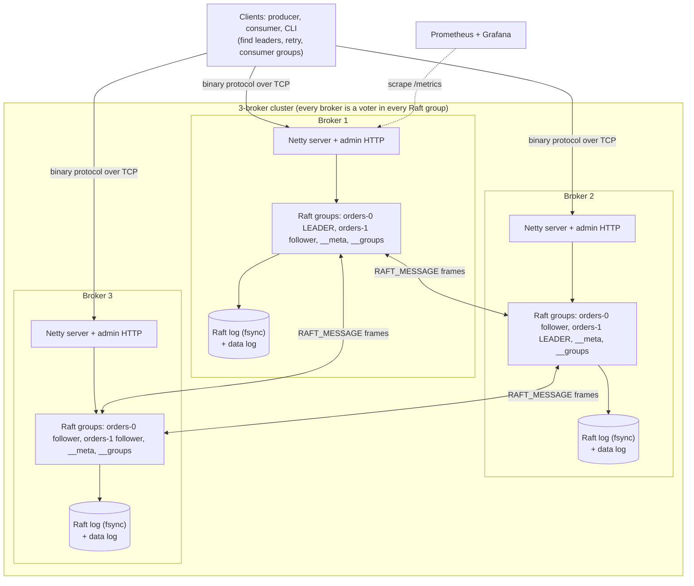
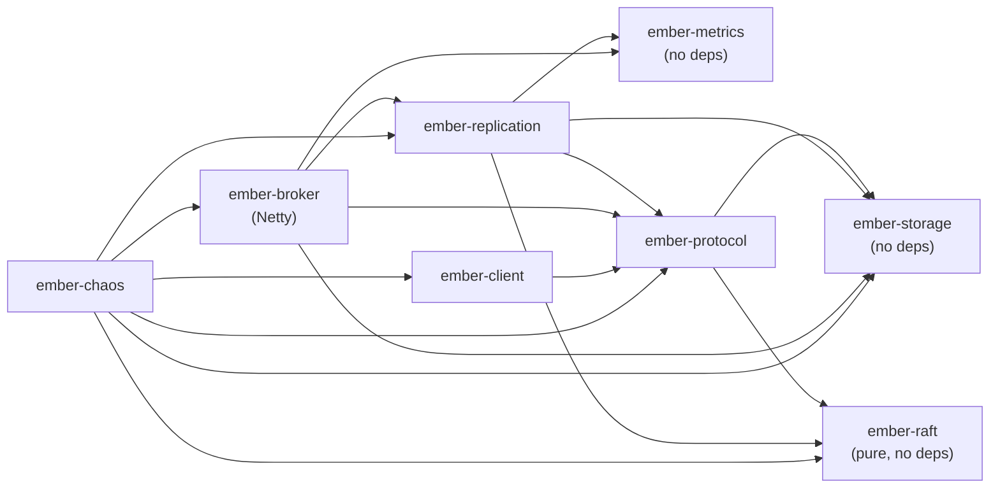
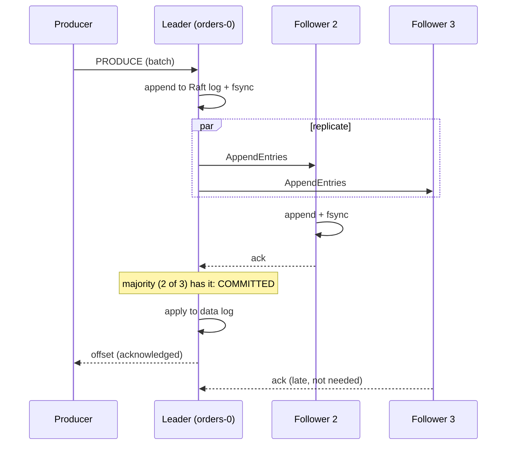
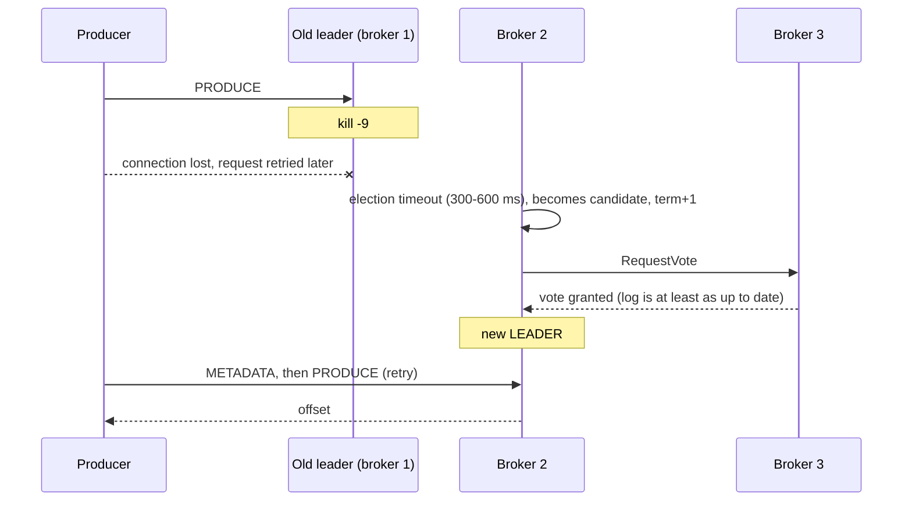
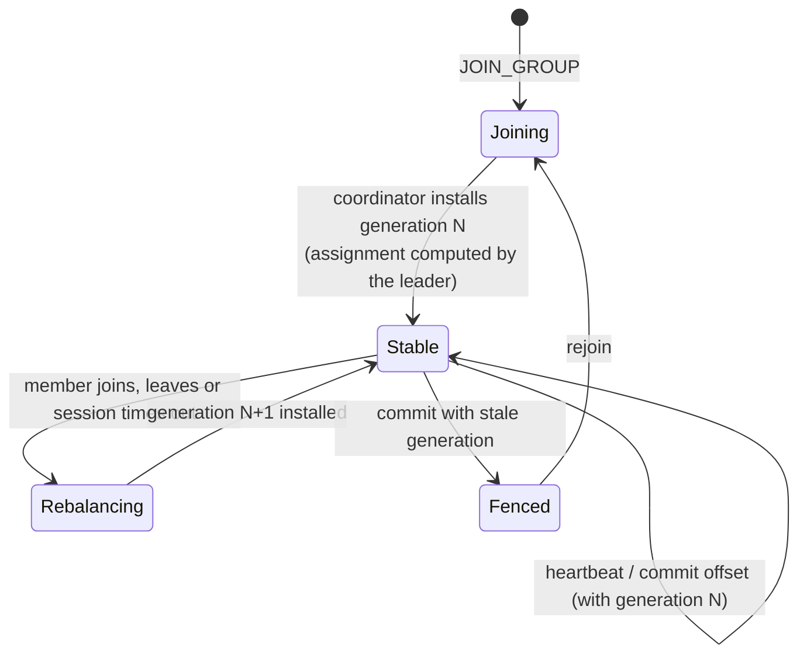
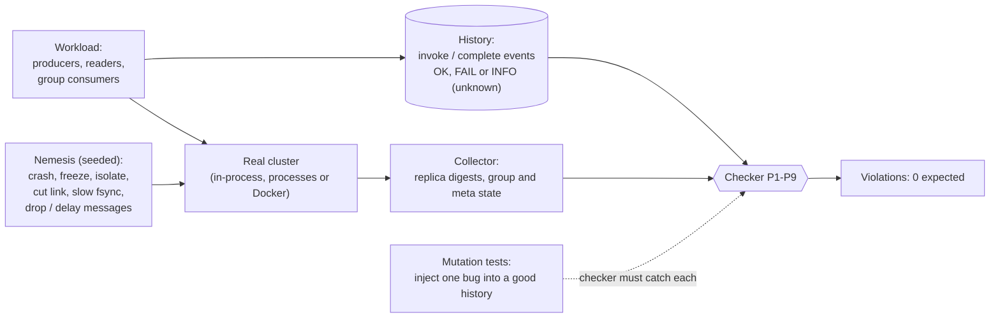

<h1 align="center">Ember</h1>
<p align="center"><b>A Kafka-style distributed message broker, built from scratch in plain Java 21.</b><br>
Raft-replicated partitions · consumer groups · observability · chaos-verified</p>

<p align="center">


</p>

Topics are split into partitions. Every partition is replicated on three brokers and kept consistent by **Raft**, so a message Ember acknowledged survives the loss of any one broker, including the leader. Consumers share work in **consumer groups** with replicated offsets. The cluster can be watched (metrics, health, status), attacked (a chaos tool with an independent history checker) and started with one `docker compose up`.

The storage engine, wire protocol, Raft, metrics library, JSON handling and chaos checker are all written in this repository. The only dependencies are Netty and the Maven shade plugin.

**Tests:** 747 tests, 0 failures (metrics 15, storage 55, raft 182, protocol 97, replication 92, client 39, broker 215, chaos 52), about 5.5 minutes; the `cluster-long` profile adds three 120 s chaos runs.

## Web console (consumer + admin)

`ember-web` is a small Java service plus a no-build browser app: a landing page, sign-in / sign-up, a **consumer** workspace (topics, browse messages, publish, consumer groups) and an **admin** console (live broker and Raft health, create topics, manage users and roles).

```bash
docker compose up -d --wait
mvn -q -DskipTests package -pl ember-web -am
java -jar ember-web/target/ember-web-0.1.0-SNAPSHOT-all.jar \
  --bootstrap=localhost:19092,localhost:19093,localhost:19094 --admin=localhost:18081,localhost:18082,localhost:18083 \
  --secret=<long random string> --admin-password=<first admin password>
# open http://localhost:8088
```

Anyone can register as a consumer; administrators are promoted from the Users page. Passwords are PBKDF2-hashed in `ember-web-data/users.json`; sessions are HMAC-signed tokens (8 h). Serve it behind TLS in real use.

### Publishing at scale

The console gateway publishes through a shared batching producer: many HTTP requests at once are collected into a few pipelined batches, and the partitions of each batch are sent in parallel over several broker connections. Requests are served on virtual threads, so thousands of publishers can wait for their acknowledgement at the same time.

* One call may carry up to 500 records: `{"records":[{"key":"a","value":"..."},...]}` returns `{"results":[{"partition":2,"offset":41},...]}` in input order (a record that failed carries an `error`).
* Back-pressure: when the producer queue is full the gateway answers **503** with `Retry-After: 1` instead of buffering without limit. Tune with `--producer-connections` (default 8) and `--producer-queue` (default 20000).
* Order is kept per key. Delivery is at-least-once, so a retry after a timeout can duplicate a record.
* `GET /api/admin/cluster` also returns the gateway's producer counters (acknowledged, failed, rejected, batches, queued, average batch).
* For Java code: `EmberProducer.pipelined(config, connections)` and `BatchingProducer`; `bench --pipeline=N` measures the first.

Measured on a cloud sandbox VM (3 brokers, fsync on, everything on one disk), Node load generator on the same machine, 6 partitions, 100-byte values, 15 s runs. Treat these as one setup, not a promise:

| Gateway | Concurrent publishers | Calls carry | Messages/s | p50 | p99 | Errors |
|---|---|---|---|---|---|---|
| before (8 threads, one shared synchronous producer) | 200 | 1 record | 495 | 376 ms | 720 ms | 0 |
| after | 200 | 1 record | 2,986 | 61 ms | 136 ms | 0 |
| after | 1,000 | 1 record | 4,448 | 208 ms | 689 ms | 0 |
| after | 3,000 | 1 record | 4,060 | 669 ms | 2,125 ms | 0 |
| after | 100 | 50 records | 50,334 | 92 ms | 150 ms | 0 |

`bench` (4 producers, batches of 100, 12 partitions): 7,346 records/s with the classic producer, 12,163 with `--pipeline=12`; with 3 partitions the two are within noise (14.8k vs 15.7k).

### Registering an app

Services connect to Ember through the console with an API key, not with a user login. As an admin open **Apps, Register app**, give it a name and the topics it may produce to and consume from (exact names, a prefix such as `ride-*`, or `*`). The key is shown once and stored only as a hash; **New key** replaces it and revokes the old one at once.

```bash
curl -X POST http://localhost:8088/api/app/topics/orders/messages -H "Authorization: Bearer emb_..." -d '{"key":"k1","value":"hello"}'
curl "http://localhost:8088/api/app/topics/orders/messages?partition=0&offset=0&limit=50" -H "Authorization: Bearer emb_..."
curl http://localhost:8088/api/app/me -H "Authorization: Bearer emb_..."
```

The brokers themselves still have no authentication: the permission check lives in the console, so keep the broker ports private and let apps reach Ember only through it.


### Apps and the SDK (publish and run workers over HTTP)

Registered apps (see above) use the console's HTTP API with `Authorization: Bearer emb_...`. Apps never see the brokers.

| Call | What it does |
|---|---|
| `POST /api/app/topics/{topic}/messages` | publish `{key, value}` or `{records:[...]}` (up to 500) |
| `POST /api/app/queues/{queue}/claim` | `{max, waitMs, leaseMs, worker}` returns `{messages:[{partition, offset, attempt, timestamp, key, value}]}`; `waitMs` (up to 25 s) long-polls |
| `POST /api/app/queues/{queue}/ack \| nack \| release \| extend` | `{worker, handles:[{partition, offset, attempt}], reason?, leaseMs?}` returns `{settled, rejected}` |
| `GET /api/app/queues/{queue}` | waiting, in flight, retrying, dead, retry policy |

A queue is allowed only if the app may consume the queue's topic. The worker name you send is prefixed with the app's id before it reaches the broker, so apps cannot ack, nack or extend each other's messages. The Node SDK ([`sdk/node`](sdk/node/README.md)) wraps this: `ember.worker(queue, handler, {concurrency})` claims, runs handlers, acks or nacks, extends leases of slow handlers and shuts down cleanly. Java code can use `QueueConsumer` directly against the brokers.

Measured on one cloud VM (3 brokers, fsync on, Node workers on the same machine), 20 ms of work per message, 3 workers x 50 concurrent handlers: 20,000 messages in 5.6 s (3,585/s); 5,000 messages of which every 100th is poison: 4,950 handled and 50 dead-lettered after exactly 3 attempts, in 2.6 s. With one of three worker processes `SIGKILL`ed after 1 s, all 3,000 messages were still handled and the 40 that were in flight on the dead process were redelivered (attempt 2). Serving the JDK HTTP server with `TCP_NODELAY` cut a claim/ack round trip from about 50 ms to 11 ms.

## Ack queues (per-message acknowledgement)

A consumer group tracks one position per partition, so one failing message blocks everything behind it and parallelism stops at the partition count. An **ack queue** tracks each message: a worker *claims* messages, *acks* the ones it finished, and anything not acked before its lease runs out goes to another worker. State lives in its own Raft group (`__acks`), so it survives the loss of a broker; the records stay in the partition logs. Many workers may share one partition. Delivery is at-least-once: a late ack from a worker that lost its lease is rejected.

```bash
java -jar ember-client-all.jar queue-create   --bootstrap=... --subscription=matcher --topic=ride-requests --lease-ms=30000
java -jar ember-client-all.jar queue-bench    --bootstrap=... --subscription=matcher --workers=8 --claim=100
java -jar ember-client-all.jar queue-describe --bootstrap=... --subscription=matcher
```

```java
QueueConsumer.createSubscription(config, "matcher", "ride-requests", true, 30_000);
try (QueueConsumer q = new QueueConsumer(config, "matcher", "worker-1")) {
    List<QueueMessage> batch = q.claim(100);     // may be fewer than exist right after a produce: poll
    // ... process each message idempotently ...
    q.ack(batch);                                 // or q.release(batch) / q.extend(batch, 60_000)
}
```

**Retries and dead letters.** `q.nack(batch, "reason")` says the messages could not be processed. They are retried after a growing delay (default 1 s doubling to 60 s) and, after `--max-attempts` failures (default 5), set aside as **dead letters** so they never block the rest. A lease that runs out counts as a failure; `release` does not. An admin retries or discards dead letters from the console (Queues page) or the CLI:

```bash
java -jar ember-client-all.jar queue-create  --bootstrap=... --subscription=payments --topic=orders --max-attempts=3 --backoff-ms=200 --backoff-max-ms=1000
java -jar ember-client-all.jar queue-dead    --bootstrap=... --subscription=payments
java -jar ember-client-all.jar queue-dead-retry   --bootstrap=... --subscription=payments --all      # or --partition=0 --offset=100
java -jar ember-client-all.jar queue-dead-discard --bootstrap=... --subscription=payments --all
```

With 12,000 messages where every 100th always fails, 8 workers finished all 11,878 healthy ones (2,916 messages/s end to end) and dead-lettered the 122 poison messages after exactly 3 attempts each. A dead letter keeps holding the partition's progress marker (`floor`) until it is retried or discarded; the record itself stays in the partition log (and is lost to the dead-letter view if retention removes it first).

Measured on one cloud VM (3 brokers, fsync on): 12,371 messages/s claim+ack with 8 workers; with 100 ms of work per batch on 6 partitions, 6 workers (the consumer-group limit) did 529 messages/s and 24 workers did 1,788 (3.4x). Design, failure behaviour and limits (no Raft snapshots yet, one `__acks` leader), including section 12 on retries and dead letters: [`docs/ack-queue/design.md`](docs/ack-queue/design.md).

## Ember Fleet: a live demo

[`demo/fleet`](demo/fleet/README.md) is a ride-dispatch system built on the pieces above: thousands of simulated drivers and riders, a tracker and matcher, billing against a flaky bank, notifications, each service a separate registered app with its own key. `node bin/scenario.js` runs it with a bank outage, always-declined cards and workers that crash after charging, then checks that every ride was matched and completed, every good card was charged exactly once, and nothing is stuck. With 5,000 drivers pinging every 4 s it sustained 1,242 pings/s, matched 608 rides (p50 181 ms) and passed all checks on one cloud VM. The console's **Live Fleet** page (administrators) shows it running: a live map, queue health, a *Break things* panel (bank outage, crashed workers) and a side-by-side comparison of the same poisoned workload through a consumer group and an ack queue: retry-in-place leaves 2,499 of 2,970 healthy messages unprocessed after 30 s, skipping loses all 30 poison messages, the ack queue finishes with nothing lost (11.1 s with 6 workers, 3.1 s with 24). `compare-bench` reproduces it. A guided tour: [`docs/FLEET-DEMO.md`](docs/FLEET-DEMO.md); what it does not prove: [`docs/LIMITS.md`](docs/LIMITS.md).

## Contents
[Architecture](#architecture) · [Design concepts](#design-concepts) · [Features](#features) · [Quickstart](#quickstart-docker) · [Guarantees](#guarantees-and-non-guarantees) · [Performance](#measured-performance) · [Testing](#how-i-tested-it) · [Failure matrix](#failure-matrix-summary) · [Structure](#project-structure) · [Build and run](#build-and-run) · [Limitations](#known-limitations)

## Architecture



* **One Raft group per partition**, plus two special groups: `__meta` (the topic list; its leader is the *controller*) and `__groups` (consumer groups, members, committed offsets; its leader is the *coordinator*).
* **Two logs per replica:** the Raft log (fsynced, the source of truth) and the data log consumers read. The data log is rebuilt from the Raft log by idempotent apply, so a torn tail is repaired on start.
* A produce is acknowledged only after the entry is **committed on a majority** of Raft logs and applied on the leader. Fetches are zero-copy from the data log and served by the partition leader only.

### Module dependencies



Boundaries are enforced on purpose: the Raft core stays pure and deterministic so a simulator can attack it; the client never imports the broker; only the broker module touches Netty.

## Design concepts

### 1. The write path (a produce request)



The leader fsyncs before sending and every follower fsyncs before answering. This is why a single acknowledged produce costs about 34 ms in the measurements below, and why the fsync is the dominant cost.

### 2. Leader failover



Only a candidate whose log contains every committed entry can win, so no acknowledged record is lost. A record that was in flight may be delivered twice by the client retry (at-least-once). Measured: median **770 ms** from `kill -9` to the first successful produce over 20 kills.

### 3. Consumer groups, generations and fencing



The coordinator is the leader of the `__groups` Raft group. Every membership change creates a new **generation**, and offset commits carry their generation. A paused "zombie" consumer waking up with an old generation is rejected, so it cannot overwrite its successor's offsets. Offsets are committed through Raft, so they survive the loss of a minority of brokers and a full restart. Rebalancing is eager by default (every member forgets its positions and restarts from the committed offsets); `--group-rebalance=cooperative` switches to a sticky assignor and a two-phase handoff in which the partitions a member keeps are never interrupted ([`docs/phase6/cooperative-rebalance.md`](docs/phase6/cooperative-rebalance.md)). Delivery is at-least-once (process, then commit).

### 4. How the system is verified: history checker



The checker does not ask the broker whether it was correct. It reads only what clients were told and what they read, and checks nine properties: no lost acknowledged write, no divergence, no phantoms, unique and increasing offsets, per-key order, reads never shrink, group delivery, commit fencing, and replica agreement. The checker itself is mutation-tested: 13 injected bugs, all caught with the expected error code. What it cannot prove is listed in [`docs/phase7/design.md`](docs/phase7/design.md).

### 5. Coordinated omission

A closed-loop benchmark waits for each reply, so during a stall it simply stops sending and records one slow request, hiding the requests that *would* have arrived. Ember's `bench --rate=N` sends on a fixed schedule and measures latency from the **intended** send time. That exposed a latency knee that a closed loop cannot show: p99 of 49 ms at 50% of max load and 143 ms at 75%.

### 6. Advertised addresses

A broker has two names: `ember2:9092` inside Docker, `localhost:19093` from your laptop. METADATA and FIND_COORDINATOR return the **advertised** address a client must use, while brokers keep talking to each other on the internal addresses (`--cluster=1@ember1:9092/localhost:19092,...`).

### Design decisions at a glance

| Decision | Why | Cost |
|---|---|---|
| Raft per partition, every broker a voter | Simple, strongly consistent, no ISR logic | Replication factor = cluster size; many groups mean many fsyncs |
| Two logs per replica | Raft log stays the truth; the data log is a cheap, zero-copy read path | Every record is written twice |
| Coordinator = leader of `__groups` | Group state replicated for free | One coordinator for all groups |
| Pure Raft core, no metrics inside | Deterministic simulation; listener turns events into metrics | Extra listener plumbing |
| Own metrics library | Rule: no libraries; learn what a histogram is | Fewer features |
| Fault hooks off by default, zero cost when off | Safe production path | Docker driver supports fewer faults than in-process |

Full reasoning for every step is in `docs/phase1..7/` (each step note covers what, why, rejected alternatives, what goes wrong, tradeoffs and tests).

## Features

* **Storage engine** (Phase 1): segmented log, sparse index, CRC per record, crash recovery of torn tails, retention, fsync policy.
* **Network and protocol** (Phase 2-3): binary request/response protocol, Netty broker with zero-copy fetch, murmur2 key routing, blocking client library and CLI.
* **Raft, proven by simulation** (Phase 4): deterministic Raft core with a simulator that attacks it with thousands of failure schedules and checks Raft's safety properties after every event; five injected classic bugs are all caught.
* **Replicated partitions** (Phase 5): per-partition Raft groups, leader failover without losing an acknowledged record, automatic catch-up, CheckQuorum, idempotent apply.
* **Consumer groups** (Phase 6): generations and fencing, eager or cooperative rebalancing (`--group-rebalance`, sticky assignor, two-phase handoff; one join caused 240 repeated records eagerly and 0 cooperatively in the integration test), session timeouts, offsets committed through Raft.
* **Observability** (Phase 7): own metrics library with Prometheus output, admin HTTP server (`/metrics`, `/health/live`, `/health/ready`, `/status`), Grafana dashboard.
* **Chaos verification** (Phase 7): history recorder, nine-property checker, nemesis, 5-minute external run against Docker (102,840 acknowledged writes, 18 faults, 0 violations) and 15-minute soak runs.
* **Benchmark tooling** (Phase 7): percentiles, warm-up, CSV, fixed-rate mode.
* **Docker** (Phase 7): 3-broker `docker compose` cluster, optional Prometheus and Grafana.

## Quickstart (Docker)

```
mvn -q package -DskipTests                        # builds the jars (also done inside the image)
docker compose up -d --build --wait               # 3 brokers; --wait returns when all are healthy
alias ember='java -jar ember-client/target/ember-client-0.1.0-SNAPSHOT-all.jar'
B=localhost:19092,localhost:19093,localhost:19094 ; A=localhost:18081,localhost:18082,localhost:18083

ember cluster status --admin=$A                                       # nodes, readiness, who leads which Raft group
ember create-topic --topic=orders --partitions=3 --bootstrap=$B
ember produce --topic=orders --count=300 --keys=30 --value=order --bootstrap=$B
ember metadata --topic=orders --bootstrap=$B                          # leader, replicas, offsets per partition
ember consume --group=shop --topic=orders --follow --bootstrap=$B     # a consumer group (run several to share the work)
ember group describe --group=shop --bootstrap=$B                      # members, assignment, committed offset, LAG

docker kill ember2                                # kill a broker (try it while a producer runs): clients carry on
docker start ember2                               # it catches up by itself
scripts/demo.sh --kill                            # the whole story, narrated
docker compose --profile observability up -d      # + Prometheus :19090 and Grafana :13000 (dashboard "Ember cluster")
docker compose down -v                            # stop and delete the data
```

Without Docker: `scripts/run-cluster.sh 3 19001 ./cluster-data` starts 3 real broker processes (`scripts/stop-cluster.sh` stops them; `scripts/demo-failover.sh` and `scripts/demo-groups.sh` are narrated `kill -9` demos).

Run the chaos tool (in-process brokers by default; 20 seconds, all fault types, exit code 0 only if the checker finds nothing):
```
java -jar ember-chaos/target/ember-chaos-0.1.0-SNAPSHOT-all.jar --duration=20 --history=history.jsonl
java -jar ember-chaos/target/ember-chaos-0.1.0-SNAPSHOT-all.jar --check-only=history.jsonl     # re-check a saved history
scripts/chaos-docker.sh 300                       # 5 minutes against the docker compose cluster
```

## Guarantees and non-guarantees

| Guaranteed (while a majority of brokers is alive and the Raft log is fsynced) | Not guaranteed |
|---|---|
| An acknowledged produce is on a majority of Raft logs and is never lost or reordered, across any number of leader changes | **Exactly-once.** Retries after a timeout or lost connection can duplicate a record (at-least-once) |
| Replicas converge to byte-identical data logs | Availability without a majority (2 of 3 down: nothing is acknowledged, nothing is lost) |
| A fetch returns only committed data | Linearizable reads from a leader that was just deposed (no ReadIndex) |
| Per-partition order; same key, same partition, same order | Ordering across partitions |
| Each consumer-group partition has one owner per generation; a stale-generation commit is rejected | Exactly-once consumption (duplicates after rebalances/crashes, bounded by the commit interval) |
| Committed offsets survive the loss of any minority of brokers and a whole-cluster restart | Durability with `--unsafe-no-raft-fsync` (benchmarks only) |
| Metrics, health and status endpoints never expose record keys or values | Security: no TLS, no authentication; the admin port is plain HTTP; peers are trusted |

## Measured performance

One laptop (**Apple M4, 10 cores, 16 GiB, macOS, Java 21**), real broker processes, **all brokers and clients sharing one SSD**; 4 producers, batches of 100; numbers are from one run each (recipe and raw files: [`docs/phase7/step9-benchmarks.md`](docs/phase7/step9-benchmarks.md), [`docs/benchmarks/`](docs/benchmarks/)). Treat them as a description of this setup, not as a claim about other hardware.

| | records/s | p50 | p99 |
|---|---|---|---|
| 3 brokers, Raft fsync **on**, 100 B, 3 partitions | 3,491 | 114.7 ms | 151.6 ms |
| 3 brokers, fsync on, 1 KB, 3 partitions | 3,841 (4.1 MB/s) | 106.5 ms | 151.6 ms |
| 3 brokers, fsync **off** (unsafe), 100 B, 3 partitions | 126,680 | 2.56 ms | 8.96 ms |
| 1 broker, fsync on / off, 100 B | 9,845 / 272,292 | 41.0 / 1.28 ms | 51.2 / 3.71 ms |
| single-record produce, fixed rate at 25% / 50% / 75% of max (117/s) | 29 / 58 / 87 | 29.7 / 30.2 / 28.7 ms | 44.0 / 49.2 / **143.4** ms |

* **Failover** (20 x `kill -9` of the partition leader, time to the first successful produce): median **770 ms** (min 583, p90 979, max 1,598) with default Raft timings; median **559 ms** with 150-300 ms elections.
* **A broker that missed 100,000 records** was ready and complete 2.2-2.8 s after its restart.
* **Consumer groups** (Phase 6): after `kill -9` of a consumer (session timeout 3 s) its partitions were reassigned after a median of 2.6 s; after `kill -9` of the coordinator broker the next commit succeeded after a median of 0.76 s; one `OFFSET_COMMIT` takes a median of 8.3 ms with fsync, 0.26 ms without.
* Honest reading: fsync is the cost (all three brokers fsync the same disk here), and 12 partitions were *slower* than 3 because the producer sends one request per partition in sequence.

## How I tested it

* **Raft core:** 1,000+ random seeds with all safety checkers, plus mutation tests (five injected bugs, each caught).
* **Whole system chaos:** real brokers, real sockets, a seeded schedule of crashes, freezes, isolations, cut links, slow fsync, dropped and delayed messages, frozen consumers. The recorded history is checked offline against nine properties. The checker is mutation-tested: one injected bug per test, each caught with the expected code, the untouched history reports nothing.
* **External runs:** 5 minutes against the Docker cluster (6 container kills, 4 freezes, 5 network isolations, 3 frozen consumers, 102,840 acknowledged writes): 0 violations. A 15-minute soak with a crash or freeze every 30-60 s and resource-trend analysis: [`docs/phase7/step8-soak.md`](docs/phase7/step8-soak.md).
* **Real bugs these tools found** (all fixed, all with regression tests): [`docs/phase7/design.md`](docs/phase7/design.md) part 7 and the "Bugs and surprises" sections of the NotebookLM documents.
* The chaos checker is a test, not a proof; what it cannot show is listed in [`docs/phase7/design.md`](docs/phase7/design.md) part 2.

## Failure matrix (summary)

| Failure | What happens |
|---|---|
| Follower crashes | Nothing visible. It replays its Raft log and catches up when it returns |
| Leader crashes | A new leader after one election (about 0.6-0.8 s measured); no acknowledged record is lost; a record in flight may be duplicated by a retry |
| Leader cut off from the others | CheckQuorum makes it step down; the majority elects a new one; its uncommitted proposals are overwritten |
| Majority lost | Nothing is acknowledged, nothing is lost; progress resumes when a majority returns |
| Controller or coordinator crashes | The other brokers elect a new one; topics, members, generations and offsets are replicated, so consumers carry on |
| Torn tail of the data log or the Raft log | Repaired on start (the data log is rebuilt from the Raft log by idempotent apply) |
| Consumer crashes or freezes | Its partitions move to the others after the session timeout; its uncommitted records are delivered again |

The full table with what the client sees: [`docs/phase5/design.md`](docs/phase5/design.md) section 5 and [`docs/phase6/design.md`](docs/phase6/design.md) section 6.

## Project structure

| Module | What it is |
|---|---|
| `ember-storage` | `Log`, segments, index, retention, flush policy, zero-copy slices (no dependencies) |
| `ember-metrics` | `Counter`, `Gauge`, `Histogram`, `MetricsRegistry`, Prometheus text format (no dependencies) |
| `ember-raft` | the pure deterministic Raft core and its simulator (no dependencies) |
| `ember-protocol` | request/response types and codecs for every API, `Partitioner` |
| `ember-replication` | `FileRaftStorage`, `GroupRuntime`, partition/metadata/group state machines, `GroupCoordinator`, `Assignor`, fault-injection hooks |
| `ember-broker` | the Netty broker, `ReplicaManager`, `PeerNetwork`, admin HTTP server |
| `ember-client` | `ClusterClient`, `EmberProducer`, `EmberConsumer`, `EmberGroupConsumer`, the CLI, bench |
| `ember-chaos` | history recorder, checker, nemesis, in-process and external runners, failover/catch-up benchmarks |

Documentation: [`docs/PROTOCOL.md`](docs/PROTOCOL.md) (byte layouts and semantics), [`docs/OPERATIONS.md`](docs/OPERATIONS.md) (runbook), `docs/phase1..7/` (one note per step explaining *why*, plus a design document per phase), `docs/ember-part*-notebooklm.md` (study guides), `docs/FLEET-DEMO.md`, `docs/LIMITS.md`, `docs/DEMO-SCRIPT.md`, `docs/INTERVIEW-QA.md`, `docs/RESUME-BULLETS.md`.

## Build and run

```
mvn clean verify                 # compiles, runs every test, builds the runnable jars (about 4-5 minutes)
mvn -q test                      # tests only
mvn verify -Pcluster-long        # also the slow tests: 60 s and 120 s chaos runs
```
Needs JDK 21 and Maven 3.9. Jars: `ember-broker/target/ember-broker-0.1.0-SNAPSHOT-all.jar`, `ember-client/target/ember-client-0.1.0-SNAPSHOT-all.jar`, `ember-chaos/target/ember-chaos-0.1.0-SNAPSHOT-all.jar`.

A broker by hand:
```
java -jar ember-broker/target/ember-broker-0.1.0-SNAPSHOT-all.jar --node-id=1 --data-dir=./data-1 \
     --cluster=1@localhost:9001,2@localhost:9002,3@localhost:9003      # run the same command with --node-id=2 and 3 (their own data dirs)
java -jar ember-broker/target/ember-broker-0.1.0-SNAPSHOT-all.jar --port=9099 --data-dir=./ember-data           # a single broker (a cluster of one)
```
Main flags (`--name=value`): `node-id`, `cluster` (`id@host:port[/advertisedHost:port],...`), `advertise`, `port`, `data-dir`, `admin-port` (default port+1000, `0` = off), `admin-host` (127.0.0.1), `enable-debug-endpoints` (off), `raft-election-min-ms/-max-ms/-heartbeat-ms` (300/600/100), `produce-timeout-ms` (5000), `unsafe-no-raft-fsync` (**unsafe**), `data-flush`, `segment-bytes`, `retention-ms/-bytes`, `default-partitions`, `max-partitions`, `max-frame-bytes`, `handler-threads`, `group-min/max-session-ms`, `group-rebalance` (`eager`|`cooperative`). More in `docs/OPERATIONS.md`. SIGTERM/Ctrl+C shuts down cleanly. The admin port is **unauthenticated**: keep it on a trusted network.

### CLI reference
```
create-topic --topic=t --partitions=N          produce --topic=t [--key=k] --value=v | --count=N [--keys=100]
consume --topic=t [--from-beginning] [--follow]    consume --group=g --topic=a,b [--from=earliest|latest] [--max=N] [--follow]
fetch --topic=t [--partition=0] [--offset=0]       metadata [--topic=t]
group describe|offsets --group=g                   cluster status|metrics --admin=h:p,...      healthcheck --admin=h:p
bench [--producers=1] [--records=200000] [--value-bytes=100] [--batch=500] [--warmup-records=0] [--rate=N] [--csv=FILE]
```
All commands take `--bootstrap=h1:p1,h2:p2` (or `--host`/`--port`) and `--retries=N`.

### The Java client
```java
try (EmberProducer producer = new EmberProducer(ClientConfig.defaults().withBootstrap(List.of("localhost:19092")))) {
    RecordMetadata md = producer.send("orders", "alice".getBytes(), "order-1".getBytes());     // md.partition(), md.offset()
}
GroupConsumerConfig config = GroupConsumerConfig.of(List.of("localhost:19092"), "shop");
try (EmberGroupConsumer consumer = new EmberGroupConsumer(config)) {
    consumer.subscribe("orders");
    while (running) {
        for (GroupRecord r : consumer.poll(Duration.ofSeconds(1))) { process(r); }              // process ...
        consumer.commitSync();                                                                  // ... THEN commit (at-least-once)
    }
}
```

## Known limitations

Replication factor = cluster size, with no adding or removing brokers; no Raft snapshots (the Raft log never shrinks and restart replays it); every record is written twice (Raft log + data log); one coordinator for all consumer groups and no compaction of the `__groups` or `__acks` logs; eager rebalancing with a non-sticky range assignor by default (cooperative mode is opt-in); the default producer sends one request per partition in sequence (more partitions can mean *lower* single-producer throughput; `EmberProducer.pipelined` sends them in parallel); one advertised address per broker (no multiple listeners); no TLS or authentication; no exactly-once or idempotent producer; no long-poll fetch; the partition count of a topic is fixed and topics cannot be deleted.

## What I would build next

Raft snapshots and log compaction; an idempotent producer (removes the duplicate caveat); pipelining across batches (today's pipelining is across the partitions of one batch); sharded group coordinators; cooperative rebalancing as the default, static membership; adding and removing brokers; tiered storage; TLS and authentication.

## What I learned

* In a distributed system the bugs live in the **glue** (thread pools, readiness checks, retries, bookkeeping), not in the consensus algorithm, which a simulator can check on its own.
* A **checker is only as good as its input**: my first chaos alarm was my own recorder writing down an acknowledgement that never happened.
* **Measure, then explain**: the 12-partition slowdown and the fsync cost were not what I expected, and the explanation (one request per partition; three brokers on one disk) came from looking at the numbers.
* A benchmark clock that includes the shutdown, or a closed loop that waits for the stall, silently lies.
* Writing down *why* before the code kept every later phase honest.
